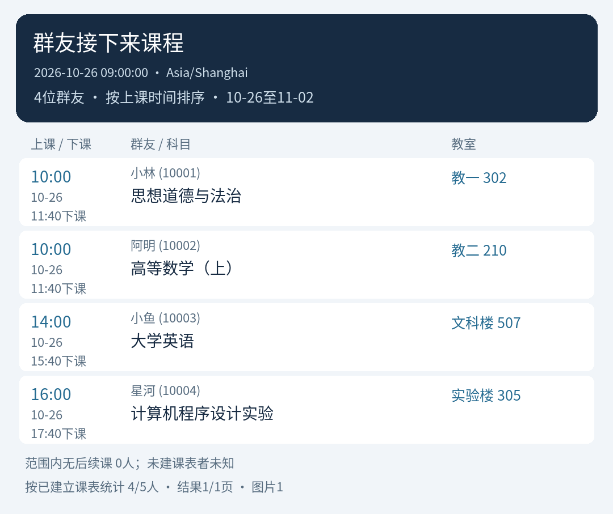
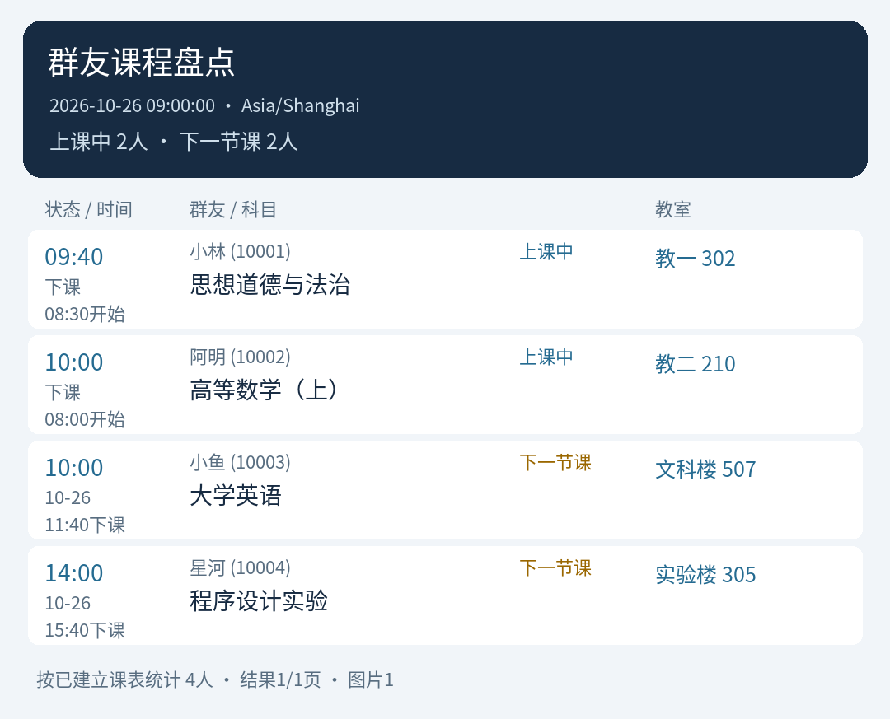
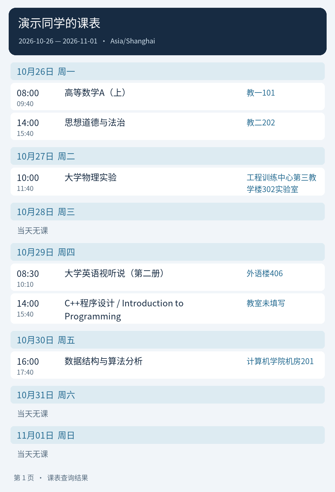

> 1.10.5：修复QQ官方带图指令取图，帮助与版本日志默认图片输出。

> 1.10.4：修复QQ官方OpenID群汇总；官方群仅汇总同群同聊天流已建立课表，无法核实离群状态。

> 1.10.3：基于1.10.2增强自然语言课表管理，支持语义查找维护目标、提醒开关和状态查询。保持群聊稳定版、10分钟Reply等待及MaiBot管理员规则，私聊与多群合并保持回滚。

# 群聊个人课表提醒

为每名群成员分别维护课表，在上课前 20 分钟调用 MaiBot 的 `ctx.maisaka.reply.generate()`，复用 Replyer 人格、表达方式选择和回复 Hook，生成简短提醒，再通过 Host 发送带真实 `@成员` 的消息并同步聊天历史。提醒正文由 MaiBot 生成；不使用固定提醒句式，也不调用独立模型 API。

[下载安装包](https://github.com/uFay0411/maibot-group-timetable/releases/latest) · [问题反馈](https://github.com/uFay0411/maibot-group-timetable/issues) · [更新日志](CHANGELOG.md)

## 安装

适用于本次验证的 MaiBot **1.3.15**、`maibot-plugin-sdk` **2.16.0**。不支持旧版 `src.plugin_system` 插件接口。主程序需要提供 `maisaka.reply.generate`、`send.hybrid`、`send.text`、`message.get_by_id`、`api.call` 和 `api.list` 能力。

1. 从 [Releases](https://github.com/uFay0411/maibot-group-timetable/releases/latest) 下载 `group_timetable-版本号.zip`，在 MaiBot WebUI 使用“从 ZIP 安装插件”。也可解压整个 `group_timetable` 文件夹到实例的 `plugins/` 下，保留 `_manifest.json` 与 `plugin.py`。升级请保留已有配置和数据。
2. 在该实例使用的 Python 环境安装 `requirements.txt` 中的依赖。例如在 MaiBot 根目录执行：

   ```powershell
   uv pip install -r plugins/group_timetable/requirements.txt
   ```

   启用插件依赖安装流程的 Host 也可根据 manifest 自动安装第三方依赖。
3. 重启或通过 WebUI 加载插件，按 Host 界面授予 manifest 中的能力。ZIP 随带完整默认 `config.toml`（来自 `config.default.toml`），不含个人设置或课表数据；源码安装也可将模板复制为 `config.toml`。
4. 在允许机器人发言的群中上传自己的 `.ics` 文件。默认自动合并导入，也可以引用这条文件消息发送 `/课表 解析`。WakeUp 用户可直接用下面的分享口令导入，再用 `/课表 今天` 或自然语言检查结果。

### WakeUp 分享口令导入（1.5.0）

在 WakeUp 中打开要导入的课表，点击分享，选择在线分享并复制口令。在群内发送：

```text
/课表 wakeup 这里粘贴32位分享口令
```

也可把完整分享文案直接粘贴到 `/课表 wakeup ` 后面，无需手动提取；含 `key=口令` 的分享链接同样可以识别。`wakeup` 不区分大小写，也可写作 `/课表 口令 ...` 或 `/课表 导入口令 ...`。

默认**合并**自己的本群课表，保留其他课程与已有本地调课。明确要替换整张旧课表时使用：

```text
/课表 wakeup 替换 这里粘贴口令或完整分享文案
```

替换会清除旧课程、加课和本地调课/停课记录。取课失败、口令失效或任一课程转换失败时，原课表保持不变。导入成功后，转换后的 ICS 也成为最近导入文件，可用 `/课表 解析` 再解析。合并相同课程安排会更新原内容并保留本地修改；从 WakeUp 删除的旧安排不会因合并而删除，需要完整同步删除时使用显式替换。

也可以 @ 麦麦并说“帮我导入这份 WakeUp 课表：”后粘贴完整文案，模型可调用 `import_wakeup_timetable` 工具。它只从本次用户的真实消息中读取口令，导入到该用户在当前群的课表；不接受模型单独传入别人的口令或成员编号。回复依据真实导入结果生成，不复述口令。

按分享数据的开学日期计算第一周，保留每周/单周/双周安排，优先使用自定义上课时间，否则读取对应节次的真实作息，缺失时间不会猜测。导入后继续支持自然语言查询、早八、加课调课和课前20分钟提醒。成功提示中的“课程安排”按不同上课时段计数，同一科目可能对应多条安排。

口令按 [WakeUp 官方说明](https://www.wakeup.fun/policy_new.html) 通常30分钟有效，过期需重新分享。插件使用新版加密 `getv2` 分享协议，直接连接 `api.wakeup.fun`，不经过第三方解析网站；口令不会写入转换后的 ICS、数据库、错误回复或插件日志。协议参考 [WakeUpDecoder](https://github.com/airline233/WakeUpDecoder)，来源及许可证见 [THIRD_PARTY_NOTICES.md](THIRD_PARTY_NOTICES.md)。已用用户授权的有效分享口令验证真实取课、转换、持久化和查询链路；未把真实口令或课表放入测试和发布包。WakeUp 协议后续变化可能需要更新插件。

升级后重载插件或重启 MaiBot，刷新自然语言导入工具；没有新增运行依赖、权限或配置项。

### SnowLuma 群文件与引用导入

1. 在统一 QQ 连接器的现有 `[notice]` 节中确认 `enabled = true`、`enable_group_upload = true`，不要重复创建同名配置节。关闭这两个开关会使群文件上传通知无法进入 MaiBot。
2. 升级课表插件后，按 Host 提示允许 `message.get_by_id`、`api.call` 和 1.2.2 新增的 `api.list` 能力。
3. 将自己的 ICS 发到群里，引用该文件消息，发送 `/课表 解析`（默认合并）或 `/课表 解析 替换`（明确替换自己的旧课表）。

插件同时支持两条路径：监听群文件上传通知并取得文件 ID，通过连接器的 `adapter.snowluma.file.get_group_file_url` 获取实际下载链接；或读取被引用的消息，必要时通过 `adapter.snowluma.message.get_msg` 取得原始文件消息段。连接器转成文本的文件摘要也可通过后一条路径恢复，不从摘要猜测文件内容。

引用编号、原消息上传者和群号必须与当前用户、当前群一致；不会修改他人课表。指定引用找不到时会报错，**不会悄悄改用最近缓存的另一份课表**。链接获取、文件读取或 ICS 验证失败时保留原课表。没有引用时 `/课表 解析` 仍解析本人最近一次有效上传。

不需要另填 SnowLuma 地址、端口或 token，全部通过已连接的适配器公开 API 调用。连接器版本必须提供上述 API；只有 SnowLuma 客户端、未加载 MaiBot 统一 QQ 连接器时不能调用。接口和通知配置依据 [官方适配器源码](https://github.com/Mai-with-u/MaiBot-SnowLuma-Adapter) 与 [官方接入说明](https://docs.mai-mai.org/manual/adapters/qq-local-client)。

1.2.2 在调用前通过 Host 的 `api.list` 读取 `maibot-team.snowluma-adapter` 实际注册的公开、已启用接口，使用返回的完整名称和版本调用。`adapter.snowluma.*` 与 `adapter.napcat.*` 是同一统一 QQ 连接器提供的两组名称，并非切换或另连客户端；优先使用已注册的 SnowLuma 名称，只有登记了另一组名称时使用该组。接口不存在、未启用或 Host 返回 `success=false,error=...` 时，会保留具体拒绝原因并提示，不再笼统误报为消息归属错误。日志和群回复中的错误信息会去掉链接和鉴权值。

1.2.1 兼容 SnowLuma 在历史记录缺少 `message_id` 时只补 `real_id` 的返回方式，以及标准 OneBot 响应包。有明确 `message_id` 时仍严格核对，不会用另一个 `real_id` 掩盖编号冲突；负数消息 ID 保留原值。若仍无法确认引用归属，群里会区分报告具体错误，插件日志中的“引用校验失败”会列出请求编号、当前群号与返回编号/群号等字段，不记录正文、文件内容、下载链接或 token。需要排查时只需提供这一行日志，无需提供完整消息响应。依据：[SnowLuma get_msg 实现与回归测试](https://github.com/SnowLuma/SnowLuma/blob/main/packages/onebot/tests/actions-message.test.ts)。

### 已有配置提示缺少 plugin.config_version

若 WebUI 配置文件只有 `[plugin]` 与 `enabled = true`，请在同一个 `[plugin]` 配置节下增加：

```toml
config_version = "1.0.0"
```

保存后由 Host 重新校验并恢复。其他已有配置保持原值；不需要清空课表或删除数据库。Host 会先检查配置版本，缺少版本号时不会先调用插件补齐默认值。插件发布版本 1.0.1 的配置结构未变，因此配置版本仍为 1.0.0。

插件源码和发布包只包含插件本身，不修改 MaiBot 主程序或实际机器人配置。

## 群内指令

### 文字/图片识别与批量维护（1.10.0）

直接发送课表文字或清晰截图并说“帮我导入课表”，也可引用原消息，再发送：

```text
/课表 文字导入 2026-10-27 08:00–09:40 高等数学 教一101，连续每周一次共8周
/课表 图片导入 学期第一周周一为2026-09-07，1-2节08:00–09:40，3-4节10:00–11:40
/课表 文字导入 替换 （课表文字）
```

插件通过宿主的 `llm.generate` 识别真实原文/原图：文字走 `utils`，图片走 `vlm`，须在 MaiBot 中配置对应模型任务。新增能力为 `llm.generate` 和 `maisaka.context.resolve_image`；无需另填模型 API 地址或密钥。图片会交给宿主已配置的视觉模型提供方识别。最多4张图片，每张8MiB、3200万像素；会保留可读文字并将长边缩至2800像素。仅有图片摘要或失效图片无法导入。

周课表请给出**学期第一周周一日期、上课周次、节次与钟点对应关系**。缺少日期/结束时间、周次不明或图片看不清时要求补充，不猜测；单双周和不连续周次展开为明确日期。教室缺失允许留空。模型输出还会经过日期、钟点、周数、条数等后端校验。

解析只生成待确认清单。核对目标、日期、上下课时间、科目、教室和周数后，在**新的消息**发送 `/课表 确认 草稿编号`，或自然语言“确认保存课表”，由模型回传刚才的草稿编号。取消用 `/课表 取消 草稿编号` 或自然语言取消。草稿30分钟有效，重启后仍可读取；最多500条、连续每周次数1~104。默认合并，只有明确要求替换时才替换旧课程和本地调课。

批量指令：

```text
/课表 批量加课 [{"date":"2026-10-27","start_time":"08:00","end_time":"09:40","subject":"高等数学","classroom":"教一101","weeks":8},{"date":"2026-10-28","start_time":"14:00","end_time":"15:40","subject":"大学英语","classroom":"教二202"}]
/课表 批量删课 真实课程编号1 真实课程编号2
/课表 批量停课 真实课次编号1 真实课次编号2
/课表 管理 @成员 图片导入 （附带/引用图片及必要说明）
/课表 管理 @成员 批量删课 真实课程编号1 真实课程编号2
```

自然语言也可说“给我批量加这几节课”“把我的高数和英语整门停用”“把明天这三节课都停一次”。模型先查询真实编号，再调用 `preview_timetable_batch` 生成预览，用户确认后由 `confirm_timetable_batch` 提交。**删课影响整门课所有周，可用恢复撤销；停课仅影响列出的课次。** 每批处理一个目标成员，批量写入在同一事务中完成，失败整批回滚；确认重试不会重复加课。确认前课表或时区变化时拒绝旧草稿，须重新预览。管理员代导入/代改在预览和确认时均实时检查身份，普通成员只能改自己。

### 群友接下来课程盘点（1.10.0）

```text
/课表 群友接下来
/课表 群友接下来 明天
/课表 群内接下来 2026-10-27 3
/课表 群友接下来 未来7天 文字
/课表 群友接下来 未来7天 第2页
```

默认发送PNG图片，也可直接问“盘点群友接下来有什么课，输出图片”。`query_group_upcoming_courses` 默认查询未来7个日历日内**每名群友的下一节课**，按实际开课时刻从早到晚，显示日期、上下课时间、成员、科目和教室；正在上的课不算下一节。同一成员同一开课时间的冲突课程全部保留。今天/明天固定当天，其余明确日期可指定1~31天，查询只取范围内当前时刻之后的课（范围末尾不含）。

仅统计同平台、当前群和聊天流中的现有成员已建立的课表，实时读取群名片并反映调课/停课，关闭个人提醒仍参与。无课表者未知，“范围内无后续课”不代表以后都无课。每页50条，长图片自动分图；文本工具结果同时返回范围内无后续课的成员信息并支持翻页。



### 指令入口

仅当前发送正文以 `/课表` 开头时进入命令链；“你看这个 /课表 清空 确认”、转发正文或引用内容里的指令不会执行。插件通过接收后的公开Hook仅规范真正命令的显示正文，保留原始引用/@/图片，所以引用ICS、引用图片仍可用；宿主原有命令启用/权限检查仍生效。manifest分类为 `plugin_type: tool`，方便WebUI分类筛选。

### 群内当前正在上课（1.9.0）

```text
/课表 群内当前
/课表 群内当前 图片
/课表 群内当前 2
/课表 群内 当前
```

也可以@麦麦问“群里谁现在在上课”“大家现在都在上什么”“谁最早下课，按下课时间排一下”，或“把群友正在上的课发成图片”。模型调用 `query_group_current_courses`，一次读取本群已建立课表的成员正在上的课，按**下课时间从早到晚**自然回答成员、科目、教室与结束时间；图片保留同一排序。每页50条，超过一页时返回下一页，指令可加页码。每次查询重新读取当时状态。

正在上课的判断为 `上课时间 <= 查询时刻 < 下课时间`：刚开始的课计入，刚好下课则不计入；跨午夜、超过24小时的持续课程和最新单次调课/停课都会正确反映。关闭个人提醒的成员仍可被查询。同一成员有多门重叠课程时全部列出，并标记课表时间冲突，不随意推断实际选了哪门课。各成员课表可使用不同的时区，下课排序按实际时刻计算，输出统一使用插件默认时区。

插件实时读取当前群成员列表，排除已离群人员及其他群/平台/聊天流的数据。只有已有课表的成员可判断，输出会标明课表覆盖人数；没有数据不能推断所有群友都没课。普通群成员可查询，不需要管理员身份；群成员接口失败时明确报错，不用过期成员资料猜测。升级后重载即可，没有新增依赖、权限或配置项。



### 管理员、群友查询与图片（1.8.0）

当前QQ群的群主和管理员可以维护同群成员课表。每次代改前，插件通过 SnowLuma 的 `group.get_group_member_info(no_cache=true)` 获取发起人的真实角色；普通成员、未知角色、接口失败或群号/成员不一致时拒绝代改。不会采用模型或消息正文声称的管理身份。普通成员仍可维护自己。

```text
/课表 群友 @小明 明天
/课表 群友 @小明 本周 图片
/课表 群友 123456789 课程
/课表 管理 @小明 加课 2026-10-27 14:00 15:40 大学物理 实验楼302
/课表 管理 @小明 调课 课次编号 2026-10-28 10:00 11:40 教二202
/课表 管理 @小明 停课 课次编号
/课表 管理 @小明 改课 课程编号 高等数学 教三303
/课表 管理 @小明 删课 课程编号
/课表 管理 @小明 恢复 课程编号
/课表 管理 @小明 清空 确认
/课表 管理 @小明 wakeup 分享口令
/课表 管理 @小明 解析
```

`@小明` 表示QQ中的真实@，也可填QQ号或群名片；含空格的群名片用引号。名字通过本群成员列表定位，重名时需明确@或QQ号。`群友` 前缀只读，不允许借此加课、导入或清空。本群已导入的成员课表可被同群成员查询，不能跨群读取；目标不在群内或没有课表时明确提示。

管理员可引用自己或目标成员在本群上传的ICS，发送 `/课表 管理 @目标 解析`，支持 `解析 替换`。有引用时严格读取该文件；无引用时读取目标成员自己的最近导入文件。WakeUp支持 `wakeup 替换 口令`。默认合并；替换或清空会移除目标本群旧课表与本地调整，不影响其他成员或群。清空需重新导入才能恢复；删课只是停用一门，可恢复。成功代改记录发起人、目标和动作类型，不记录口令、文件内容或下载链接。

自然语言例子（正常触发麦麦处理，例如@麦麦）：

- “小明明天有什么课？”
- “把小明这周的课表发成图片。”
- “帮小明后天14:00到15:40加一节物理，在实验楼302。”
- “把小明明天的高数调到后天10点，教室改成教二202。”
- “小明这门课以后都换到教三303。”
- “清空小明在本群的全部课表。”
- “把我引用的这份ICS课表导入给小明。”

`query_timetable` 新增 `target_member`、`output_format`；管理与WakeUp工具可指定管理员代管目标，新增 `import_ics_timetable` 处理明确发送/引用文件的导入。先查询目标的真实科目与课次再修改，不随意挑同名成员或课次。管理工具可回传查询返回的 `selection_token` 绑定目标；本次请求查询过群友后，漏传目标不会默认修改自己的课表。自然语言清空只在明确要求清空目标全部课表时设置 `confirm_clear=true`。

```text
/课表 图片
/课表 图片 明天
/课表 图片 本周
/课表 图片 2026-10-26 7
/课表 群友 @小明 明天 图片
```

图片直接绘制真实查询结果，含成员、日期、时区、上/下课时间、课程和教室；缺失教室标记未填写。长课表分页，最多31天、100条返回课次；截断会标明，不能据未展示日期断言无课。自然语言设 `output_format=image` 后由工具实际发送图片，麦麦再简短回复，沿用已有 `send.hybrid` 能力。



升级后在MaiBot运行环境安装更新的 `requirements.txt`（`Pillow>=10,<14`，启用依赖安装的Host可自动安装），完整更新插件并重载/重启。1.8.1已验证Pillow13的中文字体与PNG生成兼容性，可沿用现有版本，无需降级共享环境。中文字体随 `assets/` 附带，Windows/Linux无需配置系统字体。无新增权限或配置项，无需重新导入课表。

### 自然语言查询

导入课表后，可以直接在群聊中问麦麦：

- “明天有什么课？”
- “今天下午有什么课？”
- “这周有哪些课？”
- “下周一英语在哪上？”
- “我的下一节课在哪？”
- “明天有早八吗？”
- “这周哪几天有早八？”
- “下周哪几天没早八？”
- “下一次早八是什么课，在哪上？”

插件注册了对 MaiBot Planner 可见的 `query_timetable` 工具。麦麦收到提问后可调用该工具，按提问者在当前群导入的课表查询，再用 `reply` 按当前人设回答；不需要输入 `/课表`。消息需要正常触发麦麦处理（例如 @ 麦麦），是否发起工具调用由当前模型决定。工具返回真实课程、时间和教室，不通过记忆猜测。

1.3.1 修复“指令能查到，自然语言却说没有获取到明细”：MaiBot 会优先将工具的 `content` 文本交给模型，旧版本仅在结构化字段中携带明细。现在 `content` 也包含实际课程、查询范围、时区、科目、时间、教室及早八逐日统计，模型可以直接依据数据生成回答。升级后重载插件即可，无需重新导入课表或更改模型配置。

支持今天、明天、后天、本周、下周、未来7天、下一节、具体日期及本周/下周指定星期，也可按科目关键词和上午/下午/晚上筛选。相对日期按成员课表时区计算；“下一节”查找未来7天内尚未开始的课，同一时刻冲突的课程都会返回。没有导入课表会提示先上传 ICS，查询无课时明确返回无课。

1.3.0 新增早八查询：按成员时区 **08:00（含）至09:00（不含）开始的课程**筛选，08:00、08:30 开始的课都会计入，回复保留真实开课时间。“早八”属于时间筛选，不按课程名称搜索。查询一周时返回逐日有课/无课统计，停课和调课会同步反映；没有早八不代表当天没有其他课。“下一次早八”查找未来31天内尚未开始的早八，超出该窗口不作无课保证。未指定日期时默认查明天。升级后重载插件或重启 MaiBot，刷新工具时段枚举，无需新增权限或重新导入课表。

该工具只读，目标群始终从真实提问和当前聊天流确定，不能由模型指定。`message_id` 从本次提问消息的 `msg_id` 自动取得（短别名由Host还原），通过 `message.get_by_id` 读取真实发起人及群号。群友查询时只填写 `target_member`，不能换成群友的消息编号。实际提问必须属于当前群，并与Host已提供的身份字段一致。

查询工具只读；明确要求修改时，使用下面的维护工具。使用新版本覆盖插件源码时保留现有 `config.toml` 和 Host 数据目录，不要用包内默认配置覆盖自己的设置；请更新整个源码目录，包括新增的 `semantic.py`。升级后重载插件或重启 MaiBot，使 Planner 获得新的工具定义；若模型仍使用旧参数，工具会明确提示带上提问消息编号重试。

### LLM 自然语言语义查询（1.7.0）

自然语言可以直接说“明天思政在哪上”“这周有线代吗”“大英什么时候上”。科目由麦麦现有 Planner 的 LLM 基于自己的真实课表理解，支持“思政”与“思想道德与法治”这类没有字面相似度的说法；不需要把每个说法加入固定别名，也不需要配置另一个模型 API。

有科目时，`query_timetable` 首次返回本次目标成员在本群的真实科目候选，`requires_course_selection=true`，尚未查具体课次。麦麦结合原话与上下文选择真实 `course_id`，再次调用工具，传入 `course_ids` 和首次返回的 `selection_token`。token在15分钟内绑定本次提问人、消息、目标成员、日期/时段及图片格式；后续漏传目标也不会改查自己，过期需重读候选，分页也应回传token。然后才依据实际课次调用 `reply` 回答。第一次没有 `lessons` 不表示无课或缺少明细。不限定科目的问题仍一次调用直接返回课表。

候选按整张启用课表列出，不先用用户原词或日期过滤，避免相关科目尚未上课时被提前排除。候选过多会分页，模型需读完；同名科目只需选一个代表编号，插件会包含该科目的全部上课安排，并重新验证当前群/成员归属。返回的 `subject_resolution` 保留原说法、实际选定课名和编号。编号无效、课程已停用或属于其他成员时拒绝查询。

“思政”不是永远等于某一门课：如果思想道德与法治、马克思主义基本原理等多门课都可能符合，模型需要结合用户意图判断，含糊时先确认；明确要求一整类课时可选多门。选择能力取决于当前麦麦模型，不允许从候选外编造课名。已有日期、上午/下午/晚上、早八筛选和最新调课/停课状态继续生效；未说日期、只问某科什么时候上时，默认建议查未来31天。

升级到1.7.0后重载插件或重启 MaiBot，以刷新 `course_ids` 等工具参数；无需重新导入课表，没有新增依赖、配置或权限。自动测试验证真实候选、编号选择后的取课、分页和成员归属；外部 LLM 的语义判断在测试中由调用参数模拟，实际模型的选课与连续工具调用仍需机器人环境联调。

### 指令名称模糊搜索（1.6.0）

支持常用简称（高数、大英、大物、线代、概统、计网、计组、OS、马原、思修、史纲、毛概、习概），以及忽略空格、常规标点、全角和英文大小写。例如“高数A”可匹配“高等数学（A）”，“College English”可匹配“College-English”。`C`、`C++`、`C#` 保留区别。可靠名称/简称没有命中时，才尝试按顺序保留字符的中文缩写（如“数构”匹配“数据结构”）或至少4字符课名的一处增删/误写（如“线性代素”匹配“线性代数”），不进行无限制联想。

也可使用指令：

```text
/课表 搜索 高数
/课表 搜索 线代 本周
/课表 搜索 "College English" 2026-10-26 7
/课表 课程 高数
```

`搜索` 默认从今天起查询31天，也可指定今天、明天、本周、下周或具体日期；具体日期后的天数为1~31，默认1天。结果显示匹配到的真实课程名、时间、教室和课次编号，每次最多显示60节。`课程 关键词` 搜索整门课程列表，包括已停用课程，便于后续维护；自然语言维护工具的“课程列表”也使用相同匹配规则。

指令名称搜索的结果包含 `subject_matching`，标明名称规则的匹配方式及候选；自然语言语义查询则使用上面的 LLM 选课流程。调课前需要明确具体课次，维护工具仍使用真实编号。未命中所搜科目不代表当天完全没有其他课。

### 自然语言维护（1.10.3）

可以直接向麦麦提出修改请求，例如：

- “把明天的高等数学调到后天10点，教室改成教二202。”（保留原课时长）
- “明天那节英语换到教三303，时间不变。”
- “明天的高数停一次，其他周照常。”
- “后天下午14:00到15:40加一节大学物理，在实验楼302。”
- “从下周一开始，每周14:00到15:40加英语，共8次，教二201。”
- “这门高数所有周的默认教室改成教四404。”
- “把这门选修课整门停用。”
- “恢复这门课的导入课表，撤销全部本地调整。”
- “明天的思政停一次。”（结合真实科目候选语义选择，例如思想道德与法治）
- “关闭我的课表提醒。” / “重新开启我的上课提醒。”（保留课表）
- “我的课表提醒现在开了吗？”（只读查询）
- “把课表显示时区设为东京。”（Asia/Tokyo，不平移已导入课程的真实时刻）
- “把小明明天的英语调到后天14点。”（仅MaiBot内设置的管理员可代管）

插件注册 `manage_timetable` 维护工具，与查询工具使用相同的原消息身份校验。没有编号时，麦麦可先传 `match_subject`（原课程说法）及 `period`（原上课日期）读取候选；此时返回 `write_performed=false`，尚未修改。候选不会按简称字面过滤，麦麦基于真实课名进行语义选择；单次调课/停课继续通过 `query_timetable` 取得实际课次。随后传回真实编号和 `selection_token` 执行维护，用户无需复制编号。`date` 是调往的新日期，与原日期 `period` 分开。

多个匹配、没有确定具体课次或缺少加课时间时，麦麦应先询问，不猜测“第几节”对应的钟点；候选阶段不会自动任选一门写入。整门课恢复候选包含已停用课程。上下文绑定真实请求消息、群成员和维护动作，代改在实际执行前再次核验MaiBot管理员权限；QQ群主/管理员身份本身不授权代改。

调课和停课只影响一次课；单独换教室保留原日期时间；调课未指定结束时间时保留原时长。只有明确要求所有周时才使用整门课的改课/停用/恢复。改默认教室时，已有单次调课教室仍优先；恢复会撤销该课程全部本地修改和停课。工具的“课程列表”可查停用课程，便于恢复。加课即使没导入过 ICS 也能使用；一次默认只加一次，明确周数时按每周重复。

修改实际写入 SQLite，并立即影响后续查询、早八统计及提醒检查。工具返回模型可见的修改前后真实数据，再由麦麦使用 `reply` 按当前人设说明结果；失败时不会返回成功。相同消息、相同加课参数重试不会重复加课。正常触发麦麦处理（例如 @ 麦麦）后由模型决定调用工具，仍需在实际机器人中验证模型是否正确选课和传参。

提醒设置用 `action=提醒, reminder_enabled=true/false`，只读状态用 `action=状态`，时区用 `action=时区, timezone=Asia/Shanghai` 等真实IANA名称。所有设置仅影响目标成员在当前群的课表。升级后重载插件或重启 MaiBot，刷新 `manage_timetable` 工具；不需要重新导入课表，没有新增权限、依赖或配置项。

### 维护指令

未指定目标时操作**当前平台、当前群、当前发送者**；`群友` 只读查询同群成员，`管理` 仅允许当前MaiBot管理员代管指定成员。同一个人在不同群的课表分别保存。

| 指令 | 用途 |
| --- | --- |
| `/课表 帮助` | 查看全部用法 |
| `/课表 解析` 或 `/课表 解析 合并` | 有引用时读取被引用的本人 ICS，否则读取本群最近一次有效上传；更新相同 UID，保留其他课程及本地调课 |
| `/课表 解析 替换` | 用引用的本人 ICS（无引用时为最近上传）替换自己的全部课程，清除本地调课、加课和停课设置 |
| `/课表 wakeup 口令或完整文案` | 从 WakeUp 分享口令合并导入自己的本群课表 |
| `/课表 wakeup 替换 口令或完整文案` | 从 WakeUp 明确替换自己的全部课表，清除本地修改 |
| `/课表 今天`、`明天`、`本周`、`下周` | 查询课程与课次编号 |
| `/课表 查询 2026-10-26 7` | 从指定日期查询 7 天，最多 31 天；每次最多显示 60 节 |
| `/课表 课程` | 查看课程编号，包括已停用课程，便于恢复 |
| `/课表 搜索 高数 [日期或本周等] [天数1~31]` | 科目模糊搜索，默认查询未来31天，显示真实课次编号 |
| `/课表 课程 高数` | 按简称或关键词搜索整门课程，包括已停用课程 |
| `/课表 加课 2026-10-26 08:00 09:40 高等数学 教一101` | 新增一次课程 |
| `/课表 加课 2026-10-26 08:00 09:40 高等数学 教一101 16` | 从该日开始每周同一时间上课，共 16 次 |
| `/课表 调课 课次编号 2026-10-27 10:00 11:40 教二202` | 修改一次课的日期、时间和可选教室，其他周保持不变 |
| `/课表 停课 课次编号` | 取消一次课 |
| `/课表 改课 课程编号 线性代数 教三303` | 修改整门课的科目与默认教室；单次调课教室优先 |
| `/课表 删课 课程编号` | 停用整门课，保留记录供恢复 |
| `/课表 恢复 课程编号` | 撤销该课程全部本地修改与停课，恢复最近导入的内容 |
| `/课表 提醒 开`、`/课表 提醒 关` | 开关自己在本群的提醒 |
| `/课表 时区 Asia/Shanghai` | 设置显示时区和以后导入的浮动时间解释方式 |
| `/课表 状态` | 查看提醒开关、时区、已发送与发送结果未知的数量 |
| `/课表 清空 确认` | 清空自己的本群课程、修改记录与最近上传文件 |

`课次编号` 形如 `a1b2c3d4e5f6@20261026T0800`，直接复制查询结果中的内容。`课程编号` 是 `@` 前的部分，也可用 `/课表 课程` 取得。调课后再次修改，请重新查询以取得新的课次编号。含空格的科目/教室用双引号包围，例如 `"College English" "Room 101"`。

换教室而不换时间时，用“调课”填写原日期和时间即可。修改所有周的教室使用“改课”。每天的单双周、节假日停课由 ICS 的规则决定；也可以用单次停课、加课维护。

## ICS 与文件接收

- 读取 `SUMMARY` 作为科目、`LOCATION` 作为教室，支持 `DTSTART`、`DTEND` / `DURATION`、UTC、TZID、VTIMEZONE 和浮动时间。
- 使用 `icalendar` 与 `recurring-ical-events` 解析重复规则，支持每周、隔周、COUNT / UNTIL、RDATE、EXDATE、RECURRENCE-ID 调课与 STATUS:CANCELLED。保留规则按日期查询，不把无限重复课截断成固定学期。
- 只导入有具体时间的课程，跳过全天事项；没有可导入课程时拒绝操作。缺失 UID、科目、结束时间或时间错误会拒绝整次导入，原课表不变。一个文件最多 2 MiB / 5000 个事件，不支持小时、分钟、秒级重复。
- 支持 Host 的 `file` 消息段 `data.name`、`data.url` / `data.base64`，以及统一 QQ 连接器的结构化 `group_upload` 通知。QQ 文件只有 `file_id` 时通过适配器公开 API 换取下载链接；不会把本地路径或文件名当作可下载内容，不假设 OneBot 端口，不改适配器源码。
- HTTP(S) 下载有体积和超时限制，不跟随重定向。内网下载服务需在配置的 `allowed_file_hosts` 中填入实际主机名/IP（不含协议和端口）。
- 默认每次上传自动合并，不删除文件里已经消失的旧课程；换学期请明确使用“解析 替换”。合并以 UID 识别同一门课程，导出工具如果改变 UID，请使用替换模式避免重复。
- 文件内的课程名称仅当作数据传给 Replyer；不会被当作插件指令执行。科目和教室应写在 SUMMARY / LOCATION，不从 DESCRIPTION 猜测。

## 提醒与数据维护

默认每 15 秒检查一次，从课前 20 分钟开始生成提醒。实际发送时间受检查间隔和模型响应耗时影响。同一成员同一时刻有多门课时合成一条消息，添加一个真实 @。生成结果必须包含所有课程的原始科目、已知教室和 `HH:MM` 时间，否则不发送，在宽限窗口内重试；没有模板兜底。教室未填写时要求 Replyer 说明未知，不编造。

生成期间可正常调课或关提醒；发送前会重新核对当前课程。停课、删除、改教室或时间的旧提醒会被取消。默认只补发提醒时点之后 3 分钟内错过的提醒，长时间离线不会刷出全天历史提醒；不开课后补提醒。

数据保存于 Host 提供的 `ctx.paths.data_dir/timetable.sqlite3`（通常为 `data/plugins/wu.group-timetable/`）。关机维护时复制该数据库即可备份，插件热重载或进程重启不丢课表。已成功发送的提醒不会因为重启重复发送。生成阶段中断可以重试；发送阶段结果未知时保留 pending，避免平台已收到但 RPC 返回丢失造成重复 @。这种情况需要查平台记录与插件日志，插件不会把它冒充为“已发送”。状态统计是历史提醒次数，清空课程不会清空发送审计记录。

配置可通过 WebUI 调整：`plugin.enabled`、`timetable.default_timezone`、`auto_import`、`poll_seconds`、`catch_up_minutes`、`allowed_file_hosts`。时区修改不会移动已经导入课程的真实时刻；浮动时间需要按新时区重新解析。没有额外管理员命令或跨成员编辑入口。

## 验证

测试依赖 `pytest`、`pytest-asyncio`。在已安装 SDK 的 Python 环境中，从插件目录运行：

```powershell
python -m pytest tests -q
```

测试使用实际 SDK 插件声明、ICS 解析库与 SQLite，模拟 Replyer 和平台发送，不调用外部模型、不向群聊发送消息。还用本地 MaiBot 的真实 manifest 校验器验证了清单。真实 QQ 文件上传、模型生成的提醒表达和平台 @ 的最终效果仍需在运行中的机器人中联调。

参考：[MaiBot SDK 开发指南](https://github.com/Mai-with-u/maibot-plugin-sdk/blob/main/docs/guide.md)、[recurring-ical-events 文档](https://recurring-ical-events.readthedocs.io/en/stable/)。

## 从源码打包

在仓库根目录执行：

```powershell
python scripts/build_release.py
```

脚本按 manifest 版本生成 `dist/group_timetable-版本号.zip`，只包含白名单中的源码、说明、测试与示例；安装用 `config.toml` 始终从默认模板生成，不读取本机实际配置或课表数据库。GitHub 自动生成的 Source code 压缩包是源码快照，WebUI 安装请使用 Release 附件中的安装包。

### QQ官方适配器的群汇总

`/课表 群内当前`、`/课表 群友接下来`及对应自然语言、图片查询支持官方32位OpenID，也支持官方消息携带统一ID映射的情况。官方接口没有提供完整成员名单，故只读取同群同聊天流已建立的课表，显示覆盖范围及无法核实离群状态，不显示未知总人数。未建立课表的成员不列出。

OpenID与数字QQ课表分别归属原有身份，本次修复不按昵称猜测或自动迁移。需要共享旧课表身份时应在官方适配器配置准确的统一ID映射，或以新身份导入。SnowLuma继续读取并严格校验实时成员列表，接口错误不会改为读取旧名单。管理员代管中的数字QQ查人能力未因本次汇总兼容而扩展。

### 官方QQ原图导入与图片帮助（1.10.5）

带原图发送 `/课表 图片导入 学期第一周周一2026-09-07，1-2节08:00-09:40，第1至8周`；也可引用本人原图后再导入。入站原图短时缓存在插件内存（10分钟、最多16条/32MiB），解决命令消息尚未进入Maisaka上下文而取不到图的问题，不新增图片外传出口。缓存绑定平台、账号、群、发送者、消息和图片序号，后续仍严格核对原消息归属。也会尝试公开消息接口读取已保存原图；缓存过期、图片未成功到达或无法读取时要求重发，不从摘要猜课。

识别走宿主配置的 `vlm`，应选择支持图片的模型；本插件不修改实际模型配置。图片进入模型后仍可能遇到提供商限流、模型报错或超过识别时限，实际原因会返回。识别只建立预览，须本人用新消息确认后写入课表。

`/课表`、`/课表 帮助` 默认一张简明帮助PNG，`/课表 帮助 完整` 输出完整指令分页图片。`/课表 版本` 同时显示安装版本、Host/SDK兼容范围及当前版本更新日志；`/课表 更新日志 1.10.4` 可查指定旧版本。追加 `文字` 可获取可复制内容，如 `/课表 帮助 文字`、`/课表 版本 文字`。版本和日志均读取随包真实文件。QQ官方适配器目前未实现合并转发，故按用户选择使用图片收纳，不发送不受支持的转发段。
